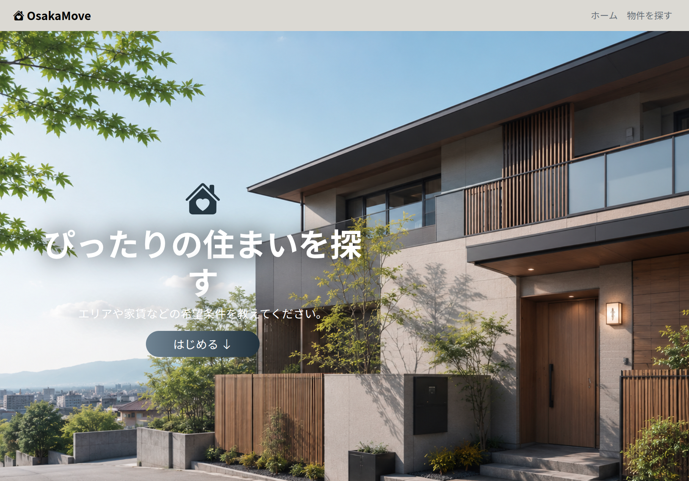
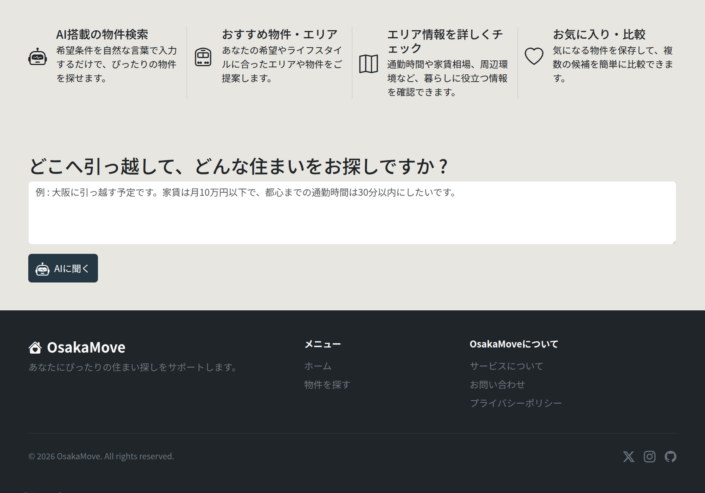
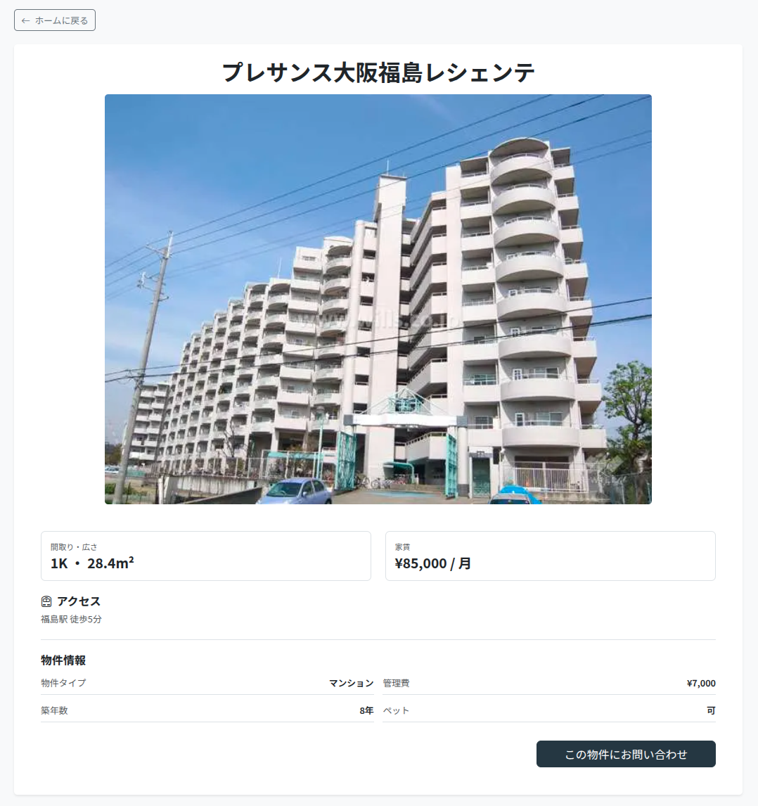

# OsakaMove 🏠

**AIを活用した大阪の物件検索Webアプリケーション**

OsakaMoveは、大阪への引っ越しを考えているユーザー向けの物件検索Webアプリケーションです。

ユーザーは自然な文章で希望条件を入力し、自分に合ったエリアや物件を探すことができます。

OpenAI APIを利用して、ユーザーの希望条件を分析し、おすすめのエリアを提案します。さらに、AIが取得した情報をアプリケーション側の検索機能と組み合わせることで、条件に合った物件を表示します。

React、TypeScript、Node.js、Expressを使用し、フロントエンドからバックエンド、AIとの連携まで実装しています。

## 📸 スクリーンショット

### ホームページ





### AI引っ越しアシスタント


### 物件詳細ページ



## ✨ 主な機能

### 🤖 AI引っ越しアシスタント

ユーザーは自然な文章で希望条件を入力できます。

**入力例：**

> 大阪に引っ越す予定です。家賃は月10万円以下で、駅から徒歩10分以内、25㎡以上のペット可の物件を探しています。

AIは入力内容から、以下の情報を取得します。

- おすすめのエリア
- 家賃の上限
- 希望する物件の広さ
- ペット可否
- 駅までの最大徒歩時間

取得した条件はJSON形式でアプリケーションに渡され、物件検索に使用されます。

### 📍 大阪のエリア推薦

AIはWeb検索を利用して大阪の地域情報を調べ、ユーザーの希望に合ったエリアを提案します。

各エリアについて、以下の情報を表示します。

- エリア名
- おすすめする理由
- おすすめ度（10点満点）

家賃、交通の便利さ、生活環境などを考えたエリア選びをサポートします。

### 🏠 条件に合った物件検索

AIが取得した情報をもとに、TypeScriptで実装した検索機能が物件データをフィルタリングします。

検索では、エリアだけでなく、家賃、広さ、ペット可否、駅までの徒歩時間も確認します。

**検索の流れ：**

```text
ユーザーが希望条件を入力
          ↓
     OpenAI API
          ↓
 エリアと検索条件を取得
          ↓
   JSONデータに変換
          ↓
   エリアによる物件検索
          ↓
   条件によるフィルタリング
          ↓
   おすすめ物件を表示
```

AIが物件情報を新しく作るのではなく、アプリケーションに登録された物件データから条件に合うものを表示する仕組みです。

### 🏢 物件カード・詳細ページ

物件一覧では、再利用できる`PropertyCard`コンポーネントを使用しています。

各カードには、物件名、家賃、間取り、広さ、最寄り駅などの情報を表示します。

カードから詳細ページへ移動すると、物件ごとの詳しい情報を確認できます。

React Routerを使用してページを管理し、物件IDに合わせた詳細ページを表示します。

### 📱 レスポンシブデザイン

Bootstrapを使用し、PC、タブレット、スマートフォンの画面サイズに対応しています。

画面の幅に合わせてレイアウトが変わるため、さまざまなデバイスから物件を探すことができます。

## 🛠️ 使用技術

### Frontend

- React
- TypeScript
- Vite
- React Router
- Bootstrap
- Bootstrap Icons

### Backend

- Node.js
- Express
- CORS
- dotenv

### AI

- OpenAI API
- Responses API
- Web Search
- Structured Outputs
- JSON Schema

### Deployment

- GitHub Pages（Frontend）
- Render（Backend）

## 🧠 設計・実装のポイント

### 1. AIと検索ロジックの分離

OsakaMoveでは、AIとアプリケーションの役割を分けています。

**AIの役割**
- ユーザーの文章を理解する
- 大阪のエリア情報を調べる
- 希望に合ったエリアを提案する
- 検索条件を取得する

**アプリケーションの役割**
- AIが取得したデータを受け取る
- エリア情報と物件データを照合する
- 条件に合った物件を検索する
- 検索結果を画面に表示する

この設計により、物件検索の条件をTypeScript側で管理できます。

AIの回答に物件検索のすべてを任せず、登録済みの物件データを使用することで、検索結果の正確さと一貫性を重視しています。

### 2. JSON Schemaによるデータ管理

OpenAI APIのStructured Outputsを使用し、AIから決まった形式のJSONデータを取得しています。

**レスポンス例：**

```json
{
  "areas": [
    {
      "id": "fukushima",
      "name": "福島区",
      "reason": "交通の便が良く、生活しやすいエリアです。",
      "score": 9
    }
  ],
  "criteria": {
    "maxRent": 100000,
    "minSize": 25,
    "petFriendly": true,
    "maxWalkToStation": 10
  }
}
```

データの形式を決めることで、AIの回答をフロントエンドの検索機能に直接利用できるようにしています。

また、TypeScriptの型定義を使用し、データの構造を明確にしています。

### 3. 再利用できるコンポーネント設計

物件情報の表示には、共通の`PropertyCard`コンポーネントを使用しています。

通常の物件一覧とAIによる検索結果で同じコンポーネントを利用することで、画面のデザインを統一し、コードの管理をしやすくしています。

また、ページ、コンポーネント、データ、型定義、検索ロジックを分けて管理しています。

### 4. フロントエンドとバックエンドの連携

ReactのフロントエンドとExpressのバックエンドを分けた構成を採用しています。

フロントエンドからExpress APIにリクエストを送り、バックエンドがOpenAI APIとの通信を行います。

これにより、OpenAI APIキーをブラウザ側に公開せず、安全に管理できます。

本番環境では、フロントエンドをGitHub Pages、バックエンドをRenderにデプロイしています。

## 📂 プロジェクト構成

```text
osakamove/
├── public/
├── server/
│   └── index.ts
├── src/
│   ├── assets/
│   ├── components/
│   ├── data/
│   ├── pages/
│   ├── types/
│   └── utils/
├── .gitignore
├── package.json
└── README.md
```

主なディレクトリの役割：

- `components/` — 共通UIコンポーネント
- `pages/` — 各ページのコンポーネント
- `data/` — 物件データとエリア情報
- `types/` — TypeScriptの型定義
- `utils/` — 物件検索・フィルタリング処理
- `server/` — Express APIとOpenAI APIの連携

## 🚀 ローカル環境での実行

### 1. リポジトリをクローン

```bash
git clone https://github.com/dicey44/osakamove.git
cd osakamove
```

### 2. パッケージをインストール

```bash
npm install
```

### 3. 環境変数を設定

プロジェクトのルートディレクトリに`.env`ファイルを作成し、OpenAI APIキーを設定します。

```env
OPENAI_API_KEY=your_api_key_here
```

**注意：APIキーをGitHubなどの公開リポジトリにアップロードしないでください。**

### 4. 開発サーバーを起動

フロントエンド：

```bash
npm run dev
```

バックエンド：

```bash
npm run server
```

ローカル環境では、通常以下のURLで起動します。

- Frontend: http://localhost:5173
- Backend: http://localhost:3001

ローカルのバックエンドを使用する場合は、フロントエンドのAPI接続先をローカルのURLに設定してください。

## 🎯 プロジェクト概要

OsakaMoveは、AIを利用した物件検索機能と、React / TypeScriptによるフロントエンド開発を組み合わせたWebアプリケーションです。

特に、以下の点を重視して設計・実装しています。

- **使いやすさ：** 自然な文章で物件を検索できるUI
- **データの正確さ：** AIの回答と実際の物件検索を分離
- **保守性：** 再利用できるコンポーネントと役割ごとに分けたコード構成
- **型安全性：** TypeScriptとJSON Schemaを使用したデータ管理
- **API連携：** React、Express、OpenAI APIを組み合わせたシステム構成
- **レスポンシブ対応：** さまざまな画面サイズに対応したデザイン

AIを単なるチャット機能として使用するのではなく、ユーザーの入力をアプリケーションの検索処理につなげることで、実用的な物件検索サービスを実現しています。

## 📌 今後の拡張

今後は、以下の機能を追加することで、さらに便利な物件検索サービスへと発展させることができます。

- 物件データと対応エリアの拡大
- 大阪の地域情報の充実
- 地域情報APIとの連携
- 物件検索・並び替え機能の強化
- UI / UXの改善

---

**OsakaMove — 大阪での新しい暮らしを、もっと簡単に。**